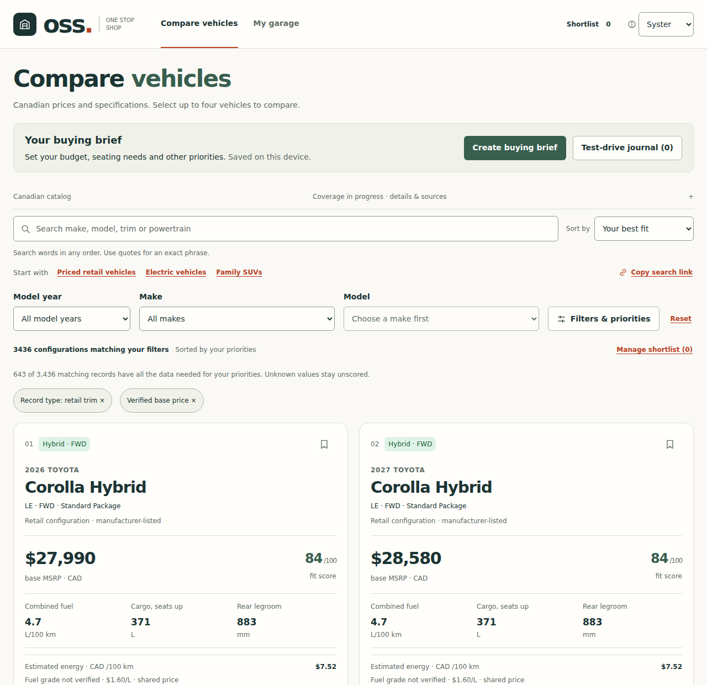

# One Stop Shop (OSS)

A Canadian new-vehicle comparison tool. Search and filter the current Canadian
market, rank configurations against your own priorities, compare up to four side
by side with estimated energy costs, and see exactly why each one fits. A
separate Garage at `/garage` tracks the vehicles you own, their service history
and manufacturer maintenance.

## What it does

- **Browse the catalog.** Search by make, model, trim or powertrain, filter by
  year, price, body style, seats, drivetrain and fuel, and use quick views for
  priced retail vehicles, EVs and family SUVs.
- **Rank by fit.** Weight price, energy cost, cargo, rear legroom and other
  priorities. **Why this fits** shows every requirement, weight, target and
  missing input behind a score.
- **Compare 2–4 configurations.** Specifications are shown side by side with
  key differences relative to a chosen reference vehicle and a fuel/electricity
  cost estimate you can adjust.
- **Plan a purchase.** An optional buying brief separates must-haves from
  preferences, and a test-drive journal records dated personal ratings and notes
  ([details](docs/BUYING-BRIEF.md)).
- **Keep a shortlist and share links.** Shortlists stay on the device with JSON
  backup and import. Searches and comparisons are shareable URLs.
- **Own a vehicle.** The Garage finds owned vehicles from 1995 onward, records
  service history and costs, schedules reviewed manufacturer maintenance and
  exports calendar and backup files ([maintenance coverage](docs/AUTOMATIC-MAINTENANCE.md)).

## Data principles

- **Every number has an official source.** Manufacturer Canadian
  configurators and Natural Resources Canada fuel-consumption ratings, linked
  from each fact.
- **Unknown stays unknown.** Missing, conflicting or unverifiable facts are
  shown with their reason, never estimated. A configuration missing data for an
  active priority is left unscored instead of ranked on partial information.
- **Prices are CAD base MSRP** before freight/PDI, fees, taxes, colours and
  options. Manufacturer prices that include those charges (Genesis's
  all-inclusive pricing, for example) are labelled separately and are never used
  as base MSRP.
- **Metric Canadian units:** L/100 km, kWh/100 km, litres and millimetres.
- **Dated research, not live inventory.** A manufacturer listing shows that a
  configuration is offered. It does not establish dealer stock, delivery dates,
  current transaction prices or reliability.

## Coverage

The catalog covers every NRCan-rated 2025–2027 vehicle, with retail trims,
prices and specifications from 25 manufacturer importers. Full Canadian
market coverage is still in progress. Some makes have no manufacturer import
yet, including Stellantis brands whose configurators reject automated requests,
and these appear only as government rating records.

For current numbers, run:

    npm run catalog:coverage   # records, verified prices and gaps by make
    npm run catalog:health     # source snapshot ages; --replay and --live verify importers

See [project status](docs/PROJECT-STATUS.md),
[Canadian market coverage](docs/CANADIAN-MARKET-COVERAGE.md) and
[catalog sources and refresh](docs/CATALOG-SOURCES.md).

## Run locally

Requires Node 22.12+ or Node 24. CI and Docker use Node 22.22.2.

    npm ci
    npm run dev

The development server runs at http://127.0.0.1:5173; the Garage is at `/garage`.

## Verify and release

    npm run check                                  # boundaries, unit tests, catalog validation, types, build
    npx playwright install chromium firefox webkit
    npm run test:e2e                               # desktop and mobile Chromium, Firefox and WebKit
    npm audit --audit-level=moderate
    npm start                                      # production server on port 8080

The production server verifies `dist` against its checksum manifest before
starting. It serves precompressed Brotli or gzip assets with security headers and
immutable caching. Set `PORT` and `HOST` as needed and put it behind HTTPS.
`npm run package:release` writes a standalone, checksummed archive to
`artifacts/` from a clean commit; it runs with `node scripts/serve.mjs` and
needs no install. To run the container:

    docker build -t oss:local .
    docker run --rm --read-only --cap-drop ALL --security-opt no-new-privileges -p 127.0.0.1:8080:8080 oss:local

See [deployment, monitoring and rollback](docs/OPERATIONS.md). External
publication is awaiting approval; see the [release report](docs/RELEASE-REPORT.md).

## Architecture

| Path                   | Contents                                                                                                               |
| ---------------------- | ---------------------------------------------------------------------------------------------------------------------- |
| `apps/oss`             | React/TypeScript UI: filtering, ranking, URL state and device persistence                                              |
| `apps/oss/src/garage`  | The Garage: owned vehicles, service history, reminders and backups ([product boundary](apps/garage/README.md))         |
| `packages/car-catalog` | Versioned source snapshots, manufacturer importers, schema, provenance and validation. It never imports an application |
| `scripts`              | Source importers, catalog checks, release integrity and the dependency-free production server                          |
| `tests/e2e`            | Browser journeys, accessibility and production HTTP checks                                                             |

The build validates the full catalog in Node and emits it as a separate, hashed,
lossless data asset, so the browser loads only a small UI and the prepared data
([catalog delivery](docs/CATALOG-DELIVERY.md)). There is no runtime database,
account service, analytics or secret configuration.

## Privacy

Shortlists, buying briefs, test-drive reviews and Garage records stay in the
browser's local storage. Backups go only where you save them. Searches, filters,
comparisons, priority weights and energy assumptions are kept in the URL, so
anyone you share a link with can see them, and they may appear in host access
logs. Briefs, reviews and the shortlist filter are never included in links.

## Documentation

- [Project status](docs/PROJECT-STATUS.md) and [roadmap](docs/ROADMAP.md)
- [Catalog sources and refresh](docs/CATALOG-SOURCES.md) and the
  [data model](docs/DATA-MODEL.md)
- [Fit scoring and specification review](docs/FIT-AND-SPECIFICATION-REVIEW.md)
- [Design system](docs/DESIGN-SYSTEM.md) and [interface review](docs/INTERFACE-REVIEW.md)
- [Garage owner directory](docs/OWNER-VEHICLE-DIRECTORY.md) and
  [maintenance sources](docs/MAINTENANCE-SOURCES.md)
- [Decisions](docs/DECISIONS.md), [release plan](docs/RELEASE-PLAN.md) and
  [operations](docs/OPERATIONS.md)

CI runs the full check, dependency audit, browser suite, release packaging and a
read-only container smoke test on every push. A weekly
[source health check](.github/workflows/catalog-health.yml) runs every importer
against its live source. Dependabot proposes dependency updates.

## Attribution

Contains information from Natural Resources Canada under the
[Open Government Licence – Canada](https://open.canada.ca/en/open-government-licence-canada).
OSS is independent and not endorsed by the Government of Canada or any
manufacturer.
